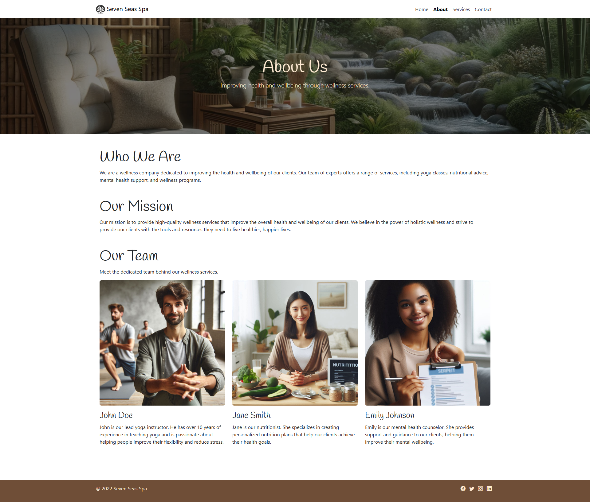
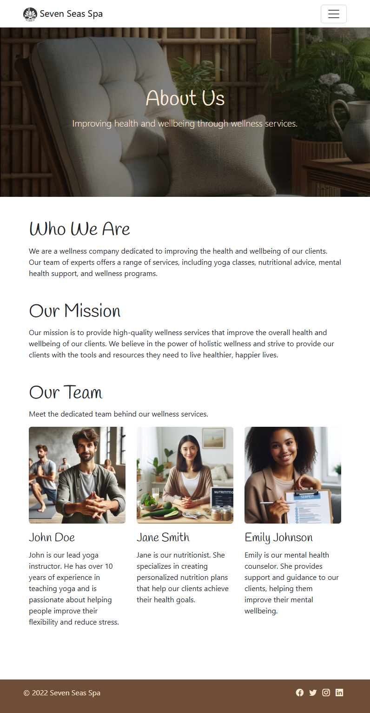
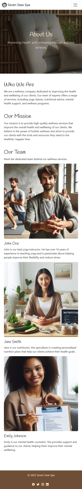

# Seven Seas Spa

A responsive wellness website for Seven Seas Spa, a fictional spa offering yoga, nutritional advice, mental health support and wellness programmes. Built as part of the Code Institute full-stack course, using Bootstrap 5 alongside AI tools (GitHub Copilot and DALL-E).

## Screenshots

| Desktop | Tablet | Mobile |
|---|---|---|
|  |  |  |

## Pages

- **Home** (`index.html`): hero banner, Our Services cards, Wellness Tips and a Testimonials carousel
- **About** (`about.html`): information about the spa and its team
- **Contact** (`contact.html`): contact form with name, email, subject and message fields
- **Thank You** (`thankyou.html`): confirmation page shown after the contact form is submitted

## Features

- Responsive navbar that collapses into a menu on smaller screens
- Hero section with a background image and call-to-action button
- Four service cards: Yoga, Nutritional Advice, Mental Health Support and Wellness Programmes
- Testimonials carousel with photos
- Footer with social media links
- Shared stylesheet across all pages

## Technologies

- HTML5
- CSS3
- [Bootstrap 5.3](https://getbootstrap.com/) and Bootstrap Icons
- [Google Fonts](https://fonts.google.com/) (Handlee)
- Git and GitHub for version control
- VS Code with Live Server

## AI tools

- **GitHub Copilot** (chat and inline chat) was used to generate and refine the HTML, CSS and commit messages. All suggestions were reviewed before being accepted.
- **DALL-E** was used to generate the hero, service and testimonial images.

## File structure

```
seven-seas-spa/
├── index.html
├── about.html
├── contact.html
├── thankyou.html
├── README.md
└── assets/
    ├── css/
    │   └── styles.css
    └── images/
```

## Testing and validation

- HTML checked with the [W3C Markup Validator](https://validator.w3.org/)
- CSS checked with the [W3C CSS Validator](https://jigsaw.w3.org/css-validator/)
- Layout checked at desktop, tablet and mobile widths

## Running locally

1. Clone the repository:
   ```
   git clone https://github.com/536738WAES/seven-seas-spa.git
   ```
2. Open the folder in VS Code.
3. Right-click `index.html` and choose **Open with Live Server**.

## Credits

- Project brief and walkthrough: [Code Institute](https://codeinstitute.net/)
- Images: generated with DALL-E
- Testimonials and people shown are fictional and for demonstration only